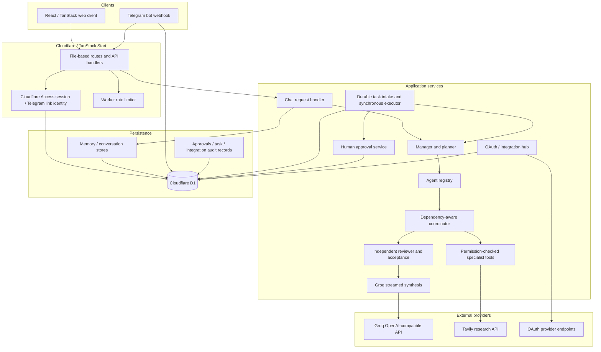

# Group 02 — Current Architecture and System Map

Snapshot: 2026-11-16  
Repository: `nonstoppp125-boop/bot-banter-room`  
Branch: `work/group06-manager-planner`  
Baseline commit: `f9521a48e2ed9f6494d6f7b01eeaf4d80cebb10a`

## 1. Architecture at a glance

The diagram shows the implemented source boundaries. It does **not** prove that a production Worker, D1 database, provider account, OAuth app or Telegram webhook is provisioned.

## 2. Frontend and routing

- React 19 + TypeScript, TanStack Start/Router, Vite and Tailwind CSS.
- File-based route tree is generated at `src/routeTree.gen.ts`; `src/routes/__root.tsx` supplies the document shell, QueryClient provider, outlet, service-worker registration and root error/not-found UI.
- Main chat page `src/routes/index.tsx` uses AI SDK `useChat` with `DefaultChatTransport({ api: "/api/chat" })`.
- Chat page also saves a prompt as a durable Manager task through `POST /api/tasks`; execution is an explicit later user action from Tasks.
- Page routes: `/`, `/tasks`, `/analytics`, `/linkedin-studio`, `/settings/approvals`, `/settings/integrations`, `/settings/memory`, `/settings/privacy`.
- Four AI-elements components are used by the chat page. The 49 `src/components/ui` primitives are available as a component library; they are not evidence that every page uses them.
- PWA shell: `public/manifest.webmanifest`, `public/sw.js`, icons, root service-worker registration. Offline/install behavior has not been browser/device-verified.

## 3. API surface

| Route | Methods | Source handler | Main responsibility |
|---|---|---|---|
| `/api/chat` | POST | `handleChatRequest` | bounded, rate-limited chat and streamed response |
| `/api/health` | GET | `createPublicHealthResponse` | public health response |
| `/api/auth/session` | GET | `handleCloudflareAccessSessionRequest` | validate Access assertion and create app session |
| `/api/auth/logout` | POST | `handleSessionLogoutRequest` | revoke session and clear cookie |
| `/api/tasks` | GET/POST/PATCH | `handleTaskRequest` | create/list/cancel/retry/unlock/recover durable plans |
| `/api/tasks/execute` | POST | `handleTaskExecutionRequest` | explicit synchronous Manager execution |
| `/api/approvals` | GET/POST | `handleApprovalRequest` | create/list/decide approvals |
| `/api/memories` | GET/POST/PATCH/DELETE | `handleMemoryRequest` | user/workspace-scoped memory |
| `/api/analytics` | GET/POST/DELETE | `handleAnalyticsRequest` | analytics snapshot ingestion/query/deletion |
| `/api/integrations` | GET | `handleIntegrationListRequest` | integration catalog and connection status |
| `/api/integrations/oauth/start` | POST | `handleOAuthStartRequest` | OAuth authorization transaction |
| `/api/integrations/oauth/callback` | GET | `handleOAuthCallbackRequest` | validate callback and persist connection |
| `/api/integrations/disconnect` | POST | `handleIntegrationDisconnectRequest` | revoke/remove connection |
| `/api/integrations/refresh` | POST | `handleConnectionRefreshRequest` | refresh connection credentials |
| `/api/account/export` | GET | `handleDataExportRequest` | export user data |
| `/api/account/deletion` | GET/POST | `handleAccountDeletionRequest` | account-deletion request lifecycle |
| `/api/telegram/link-token` | POST | `handleTelegramLinkTokenRequest` | create one-time account link token |
| `/api/telegram/webhook` | POST | `handleTelegramWebhookRequest` | verify and process Telegram updates |

API wrappers obtain bindings from `request.runtime.cloudflare.env`; service modules accept typed environment objects and are tested independently.

## 4. Backend and provider layer

- Cloudflare Worker runtime is built through TanStack Start/Nitro.
- `AgentEnv` exposes `ACTION_DB`, `CHAT_RATE_LIMITER`, `GROQ_API_KEY`, optional `TAVILY_API_KEY`, optional `GROQ_MODEL` and `DOOT_MULTI_AGENT`.
- Groq is the current LLM provider through the OpenAI-compatible endpoint `https://api.groq.com/openai/v1`; default model is `openai/gpt-oss-20b`.
- Tavily is optional for live research. Missing Tavily configuration must not be represented as successful live web research.
- No multi-provider failover/routing layer is evidenced in current code. Model override and usage/cost estimation exist; estimates are not provider billing statements.
- Chat rate limiting uses the Cloudflare Worker binding `CHAT_RATE_LIMITER`; tracked config sets 30 requests per 60 seconds. Missing/unavailable limiter fails closed with 503; denied requests return 429.

## 5. Agent workforce and manager

- Agent contract: `AgentDefinition` in `src/lib/agents/types.ts`; each agent declares id/name/description, capabilities, permissions, role and either a chat `run` handler or specialist `generate`/optional usage-aware generator.
- Registry validates unique IDs, supported capabilities/permissions and role-specific handlers. Current registry contains the default Liza chat agent plus 22 specialist definitions.
- Permissions are deliberately narrow: `llm:inference`, `research:search`, `research:extract`, `coding:validate-command`.
- Manager creates a deterministic candidate plan, computes complexity/risk/approval flags and bounded execution budgets. LLM decomposition is used only for complex plans with multiple candidates; returned JSON is constrained to registered candidates, max four subtasks, bounded objectives and acyclic dependencies. Invalid planner output falls back to deterministic planning.
- Persisted Manager plans are revalidated against the current registry and task text before execution; stored plans cannot add permissions, risk decisions or budgets.
- Coordination validates task IDs, duplicate/cyclic dependencies, timeouts and retry counts; it executes dependency-ready tasks concurrently with AbortSignal cancellation, bounded attempts, per-task timeouts and per-agent metrics.
- Orchestrator runs specialists, performs at most one bounded replacement pass for eligible failed tasks, sends both success and failure evidence to an independent reviewer, evaluates acceptance criteria and streams final synthesis.
- Specialist outputs are plain text (plus optional token usage), not a shared structured domain schema. The independent reviewer returns a constrained JSON acceptance report.

## 6. Tool execution boundary

Only three statically registered tools are exposed by `specialist-tools.ts`:

1. `research.search` — server-keyed Tavily search.
2. `research.extract` — extract one to three validated selected sources.
3. `coding.validate-command` — validate a bounded command against an allowlist.

The tool gateway checks the specialist's registered permission before dispatch. There is no general shell executor in this web runtime and no live social publishing or arbitrary external messaging tool.

## 7. Integration layer

- Integration catalog includes LinkedIn, Instagram, Facebook, YouTube, X, TikTok, GitHub, Google Drive, Gmail, Google Calendar, Slack, Discord, Notion and Telegram.
- Current provider definitions set `connectionStatus: "not-connected"` and `liveActionsEnabled: false`.
- OAuth source supports state, PKCE, callback validation, transaction replay protection, encrypted verifier/credentials and D1 connection storage.
- Integration authorization checks owner/actor identity and granted scopes.
- Webhook utilities include HMAC-SHA256 verification and replay claims.
- Provider app credentials, review, granted scopes, refresh-token validity and live actions remain external prerequisites.

## 8. Architecture decisions and gaps

| Area | Current source reality | Target / missing capability |
|---|---|---|
| Chat identity | Chat can run without a session; active session enables optional saved-memory context | A globally authenticated web workspace is not enforced by the chat route |
| LLM providers | Groq only; Tavily optional for research | Multi-provider routing/fallback not implemented |
| Integrations | Catalog/OAuth/credential stores; all live actions disabled | Real provider publishing/messaging not enabled |
| Task execution | D1 task intake plus explicit synchronous POST execution | No queue consumer, scheduled worker or automatic background execution |
| Persistence | D1 adapters and 15 migrations in source | D1 provisioning, migration application and binding not verified |
| Analytics | normalized snapshots, calculations and D1 adapter | No verified live platform ingestion |
| Retention | policy metadata and account-deletion workflow | Scheduled retention enforcement/backup restore not verified |
| Observability | structured event/health/readiness helpers and analytics | No deployed log/alert/trace pipeline verified |
| Deployment | manual main-only workflow with explicit confirmation | production environment/secrets and generated D1 binding not verified |

## 9. Deployment configuration warning

Tracked `wrangler.json` contains the `CHAT_RATE_LIMITER` binding but no `d1_databases` entry. The manual deploy workflow explicitly requires the generated Wrangler config to contain an `ACTION_DB` D1 binding with a non-empty `database_id`. Until that binding is supplied and the migrations are applied in the target account, deployment is expected to fail its own pre-deploy validation or lack durable storage. Do not invent a database ID or provision infrastructure as part of this architecture mapping.
