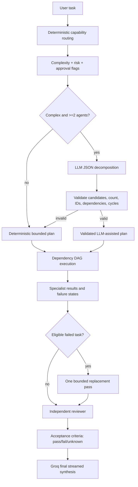

# Group 02 — Request, Streaming and Execution Lifecycle

Baseline: `f9521a48e2ed9f6494d6f7b01eeaf4d80cebb10a`

## 1. Web chat request

```mermaid
sequenceDiagram
  participant UI as Chat page (useChat)
  participant Route as POST /api/chat
  participant Limit as Worker rate limiter
  participant Orch as handleChatRequest
  participant Manager as Manager / planner
  participant Agents as Specialist coordinator
  participant Review as Quality reviewer
  participant Groq as Groq API
  UI->>Route: UIMessage[] JSON
  Route->>Orch: request
  Orch->>Limit: key chat:<cf-connecting-ip>
  alt limiter absent, unavailable or IP absent
    Limit-->>UI: 503 (fail closed)
  else rate exceeded
    Limit-->>UI: 429 + Retry-After
  else accepted
    Orch->>Orch: require GROQ_API_KEY; bounded body read; validate messages
    Orch->>Orch: optionally load user-scoped memory from active session
    Orch->>Manager: deterministic routing + risk/complexity plan
    opt complex plan with 2+ specialists
      Manager->>Groq: constrained JSON task decomposition
      Groq-->>Manager: candidate subtasks
      Manager->>Manager: validate IDs, count, objectives, dependencies and cycles
    end
    Manager->>Agents: execute dependency-ready specialists
    Agents->>Groq: specialist generation
    Agents-->>Review: success + explicit failure evidence
    Review->>Groq: independent acceptance review
    Review-->>Orch: pass/fail/unknown criteria
    Orch->>Groq: final streamed synthesis
    Groq-->>UI: AI SDK UI message stream
  end
```

### Request controls

- Maximum request body: 1 MiB, enforced while streaming the body (not only via Content-Length).
- Maximum messages: 100; parts per message: 200; text part: 20,000 chars; aggregate text: 100,000 chars.
- Only `user` and `assistant` roles are accepted; client-supplied system/developer messages are rejected.
- Chat is IP-rate-limited at the Worker edge; missing limiter configuration fails closed.
- Missing `GROQ_API_KEY` returns a server configuration error.
- Saved memory is optional: only an active `__Host-liza_session` and `ACTION_DB` permit retrieval. Up to six user-authored memories are selected, bounded and labelled untrusted reference data.
- Basic chat does not require an app session; this is different from task, approval, memory-management and account APIs.

## 2. Manager planning and specialist execution



- Manager maximum: four specialists; max parallel agents up to four; 45-second per-specialist timeout; up to two attempts.
- Coordinator hard limits: 32 tasks, concurrency up to eight, timeout up to 60 seconds, attempts up to two.
- LLM planning cannot introduce new agents or authority; deterministic risk, permission and budget fields remain authoritative.
- One bounded replan may replace a failed specialist with an unused specialist sharing a capability; skipped descendants are not retried.
- Final synthesis must state failed/skipped tasks and acceptance limitations. It must not claim external actions occurred.

## 3. Durable task intake and explicit execution

```mermaid
sequenceDiagram
  participant UI as Chat / Tasks UI
  participant API as /api/tasks
  participant D1 as D1 task + approval stores
  participant Run as /api/tasks/execute
  participant Orch as Manager orchestrator
  UI->>API: POST {task}
  API->>API: verify session, workspace membership, same-origin JSON
  API->>API: deterministic Manager plan
  alt high risk
    API->>D1: create approval record + needs_approval task
  else low risk
    API->>D1: create queued task
  end
  API-->>UI: persisted plan/status
  UI->>Run: explicit POST {taskId}
  Run->>D1: re-check session, membership, ownership, task state and saved plan
  alt approval missing/invalid
    Run-->>UI: 409; no execution
  else queued and authorized
    Run->>D1: atomic queued -> running claim
    Run->>Orch: run synchronously with request AbortSignal
    Orch-->>Run: streamed result
    Run->>D1: persist completed/failed/cancelled result
    Run-->>UI: bounded JSON result
  end
```

- `POST /api/tasks` stores a plan; it does not execute agents.
- `POST /api/tasks/execute` is the explicit execution action. It has a 2 KiB request cap, a 110-second timeout, output cap 180,000 characters and client-disconnect cancellation.
- Durable statuses: queued, running, completed, failed, cancelled, needs_approval.
- Task retry is bounded; stale running tasks can be manually recovered after five minutes. Source explicitly states no background worker heartbeat is configured.
- No queue consumer, scheduled execution or automatic background execution is present in tracked Worker config.

## 4. Approval lifecycle

- High-risk pattern matching sets `approvalRequired` on the Manager plan for publishing/messaging, destructive changes, deployment/release, financial actions and account/permission changes.
- Task intake creates an approval record bound to a payload hash, workspace, user and expiry (24 hours).
- Approval API requires active session and workspace membership; listing/deciding is admin-only.
- Decision is a conditional D1 update from pending and not expired; task unlock verifies approved status, action type and payload hash again.
- This is a durable task workflow. A high-risk chat response itself is not an external action; live external-action tools remain disabled.

## 5. OAuth and Telegram flows

- OAuth start: authenticated workspace user -> provider catalog and scope validation -> state + PKCE -> persisted transaction. Callback checks provider/state/redirect/code/expiry/replay and stores encrypted credentials.
- Telegram: user requests one-time link token -> token is linked to Telegram identity -> webhook validates configured secret and update replay claim -> resolves linked user/workspace -> uses the agent workflow. This channel has its own webhook/link-token identity boundary; it is not the browser cookie session.
