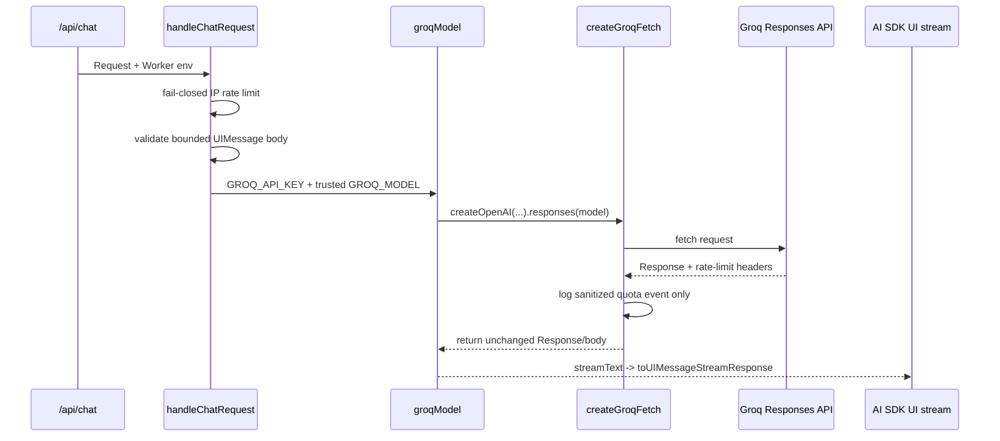

# Group 03 — Provider and Backend Request Lifecycle

Baseline: `50d9bcbe8c605f16cf8f9c23ad2bbc8b1c08c88b`

## Provider construction and streaming

## Runtime contract

- Endpoint: `POST /api/chat`; AI SDK `UIMessage[]` request and UI-message event stream response.
- Environment: `GROQ_API_KEY` required; `GROQ_MODEL` optional trusted override; `DOOT_MULTI_AGENT` only enabled by exact string `"true"`; `TAVILY_API_KEY` optional research tool key.
- Groq base URL: `https://api.groq.com/openai/v1`.
- Default model: `openai/gpt-oss-20b`, using the OpenAI-compatible Responses API adapter.
- Provider request options: one retry; total request timeout 45 seconds; first chunk 20 seconds; subsequent chunk timeout 15 seconds.
- The caller's AbortSignal is propagated. Disconnect/cancellation is not converted into a successful result.
- Provider details and credentials are not returned to the client; streaming errors use a generic safe message.

## Quota telemetry

`src/lib/agents/groq.ts` wraps the provider fetch. It reads only:

- `x-ratelimit-limit-requests`
- `x-ratelimit-remaining-requests`
- `x-ratelimit-reset-requests`
- `x-ratelimit-limit-tokens`
- `x-ratelimit-remaining-tokens`
- `x-ratelimit-reset-tokens`
- `retry-after`

A structured `groq.rate_limit` event is emitted when at least one quota header is present or the response status is 429. The wrapper returns the same Response without consuming its body. No request payload, completion text, authorization header, API key or user identifier is logged.

Five focused tests cover header extraction, missing headers, unchanged stream response, 429 without quota headers and no telemetry for an ordinary response. Existing Groq provider construction test also asserts that the wrapped fetch is passed to the SDK.

This is response-level telemetry visible in Worker logs. It is not a durable usage database, organization-wide polling service or quota dashboard. The wrapper is exercised by five focused tests and preserves the same Response/body for streaming.

## Usage and cost estimates

Multi-agent execution aggregates provider-reported usage when available and estimates missing token counts from bounded character counts. `pricing.ts` estimates cost from a dated model price table. The final execution report labels this as an estimate and explicitly notes unreported calls/final synthesis assumptions. It is not an invoice or exact billing record.

## Worker runtime verification

CI starts a local Wrangler 4.162.0 workerd instance using wrangler.stream-test.json, requests a fixture that emits an AI SDK UI-message stream, and asserts text/event-stream plus the expected text delta. This validates Worker-runtime stream delivery; it does not call Groq or prove a deployed production Worker is configured.

## Failure policy

1. Input validation and rate limiting happen before provider calls.
2. Provider call has a bounded single retry and timeouts.
3. AbortSignal is passed through the orchestration/provider layers.
4. A provider 429 is visible in quota logs; the client receives a generic safe error after the bounded retry fails.
5. No automatic cross-provider fallback occurs.
6. Multi-agent specialist failure can trigger one bounded same-provider replacement pass; if all specialist/reviewer work fails, the default Liza path may be used. This is workflow fallback, not provider failover.
